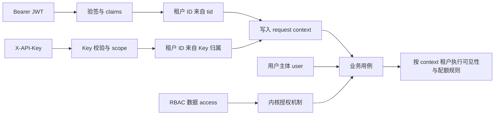

# 身份与租户设计

## 背景与范围

用户主体、认证流程、凭证、访问控制和租户上下文相互协作，但有不同的数据所有者和生命周期。将这些职责混在一个能力中，会让用户管理、认证机制或租户业务无法独立组合。

本文定义身份相关能力与内核机制的边界，以及租户身份进入业务上下文的路径。路由、配置段、表和能力依赖从对应描述符、迁移与 profile assembly 派生，不在本文复制易变清单。

### 设计目标与非目标

设计目标：

- 用户主体与用户账户用例由 `user` 统一拥有。
- 认证、MFA、Passkey、API Key 和 RBAC 数据各自归属明确，并通过 contract 协作。
- 租户上下文只能来自已验证的身份凭证，业务层使用统一的 context 读取入口。

非目标：由内核拥有用户或租户业务数据，或允许请求参数覆盖凭证中的租户归属。

## 设计方案

### 职责归属

| 部分 | 负责内容 |
|---|---|
| `user` | 用户主体、自助账户面和管理面；管理与自助用例共用用户仓储、配额校验及租户可见性 |
| `tenant` | 租户实体、套餐与配额、租户管理和开通式注册 |
| capability `access` | 角色、权限、用户角色分配及其持久化 |
| `auth` | 密码、会话、登录与密码历史及认证流程编排 |
| `mfa` | TOTP 与可信设备 |
| `passkey` | WebAuthn 注册、无密码登录和凭证管理 |
| `apikey` | API Key 签发、校验、撤销和 scope |

能力包与同名内核包属于不同层次：[`internal/kernel/access`](../../internal/kernel/access) 提供 Casbin 强制器、策略加载和权限中间件；[`internal/capabilities/access`](../../internal/capabilities/access) 管理 RBAC 数据和角色分配。`internal/kernel/auth` 提供 JWT、Session、限流和登录失败锁定机制；`internal/capabilities/auth` 实现认证用例。

### 能力间协作

能力间只通过 `internal/contract` 端口协作。`user` 将角色分配委托给 `access`，并可消费 `tenant` 的配额校验；`auth` 可消费 MFA、租户开通、泄露口令检查和验证码校验；`passkey` 通过 `LoginFinalizer` 复用认证能力的登录收尾。端口接口见 [`internal/contract`](../../internal/contract)，提供方由 profile assembly 决定。

### 租户上下文流转

1. JWT 路径先验证 token，再从已验签的 `tid` claim 读取租户身份。
2. API Key 路径先校验 Key，再从 Key 记录读取其租户归属。
3. 对应中间件将租户身份写入请求上下文；业务代码通过 `tenant.FromContext` 读取，不自行解析客户端输入。

缺少租户上下文时，`FromContext` 返回 `0`，用于平台级视角；它与默认租户 ID 是不同概念。

### 用户与认证用例协作

`user` 持有用户主体、自助账户操作和管理操作。`auth` 持有凭证认证与会话用例，登录流程按需消费 MFA、tenant provisioning、breach 与 captcha 端口；`passkey` 持有 WebAuthn 凭证并通过 `LoginFinalizer` 复用 auth 登录收尾。`apikey` 持有 API Key 数据和验证入口。管理用例需要分配角色时，经 contract 委托 `access`，不会直接访问其 repository。

用户管理统一挂在 `/api/v1/users` 资源下，不按管理员类型拆分 `/admin/users` 路由。平台级身份可以跨租户筛选和创建用户，创建时必须指定 `tenant_id`；租户级身份的范围由上下文租户强制收敛，不能通过请求参数越界。停用使用 `PUT /users/{id}` + `status=0`；删除使用 `DELETE /users/{id}` 软删除并从常规查询中隐藏，最后一个有效平台超管删除返回冲突。平台管理范围目前由“具备 `GET /api/v1/tenants` 权限”这一授权事实标记，租户管理员不授予该权限时保持租户隔离；该标记不替代具体的用户资源权限。用户创建与 `role_ids` 写入在同一事务内完成；角色 ID 在目标用户所属租户内校验。列表和详情通过 contract 端口回填租户与角色摘要。

角色管理统一挂在 `/api/v1/roles` 资源下。首版仅平台管理员可访问角色与权限目录的管理端点，平台身份通过 `tenant_id` 选择目标租户；角色创建后归属不可修改。内置角色为 `platform_super_admin`、`platform_auditor`、`tenant_admin`、`tenant_member`，使用稳定 code、`platform|tenant` scope 和 system 标记识别；系统角色禁止通过业务 API 改名、停用、删除或替换权限。Casbin subject 使用 `role:<id>`，平台范围由角色 scope 决定而不是权限存在性；tenant scope 角色不能持有平台专属权限。默认租户只持有两个平台角色，非平台身份不得管理默认租户用户。`POST /tenants` 与开通式注册在各自事务内创建 `tenant_admin`、`tenant_member`；`PUT /api/v1/roles/{id}` 传 `status=0|1` 停用或恢复，`DELETE /api/v1/roles/{id}` 永久删除未分配给用户的自定义角色并清理其权限关联，已分配给用户返回 `409`。用户角色分配与 Casbin 策略加载只接受启用且未删除的角色；移除、停用或删除最后一个有效 `platform_super_admin` 用户返回冲突，检查先锁平台角色行再计数。角色权限整体替换在事务内校验全部权限 ID，角色或授权变更会在事务成功后失效当前进程的策略缓存；跨副本一致性仍由各自缓存 TTL 约束。

审计列表、详情和导出按身份范围收敛：平台身份读取全部租户，租户身份只能读取当前租户；详情跨租户按不存在处理。

### 会话身份与权限点的下发（`/auth/me`）

`GET /api/v1/auth/me` 是自助端点，挂在 auth 的**认证-only 子组**（只有 `auth.AuthMiddleware`，不套授权与租户中间件），它的身份与权限来源有明确口径：

- **身份取自已验签的凭证，不取数据库、也不取请求参数。** `user_id` 与 `tenant_id` 均读 `auth.AuthMiddleware` 写入 gin context 的值（`c.Set("user_id", …)`/`c.Set("tenant_id", …)`），其中 `tenant_id` 就是已验签 token 的 `tid` claim，与审计中间件读同一处。**不读账号行的 `tenant_id`** —— 数据库里的归属可能滞后于签发时的凭证归属；也**不能用 `tenant.FromContext`** —— 该子组不套 `tenant.Middleware()`，`FromContext` 在这里恒返回 `0`。
- **权限点由 `kernel/access` 的角色与策略查询派生、原样透出。** `roles` 来自 `DBAuthorizationStore.RolesForUser`；`permissions` 由同一 store 的 `Policies` 取到「角色 × (resource, action)」全量后，在 auth 的 application 层**按用户角色过滤、去重、按 `(resource, action)` 排序**再下发，不翻译成额外权限码。判定语义与 `conf/rbac_model.conf` 的 matcher 完全一致，因此客户端复刻 `keyMatch(请求路径, resource)` 与 `action == "*"` 即可得到与后端相同的结论。
- **零角色不是错误。** 无任何角色的用户（如公开注册的账号）返回 `200` 与两个空数组；`roles` 仅供展示，授权判定一律用 `permissions`。

### 租户数据规则

- 用户、角色、审计等业务数据依据各自模型中的租户归属字段隔离；资源可见性由业务仓储或用例根据 context 执行。
- 套餐、配额、用量及租户管理由 `tenant` 持有，消费能力通过 contract 请求校验。
- 固定默认租户用于无归属资源的创建默认值；context 中的 `0` 表示平台级视角，可见范围更宽，不代表默认租户。
- 租户 schema 迁移依赖可能补入迁移集合，但不由此启用租户业务能力。

## 关键决策

- **用户主体与账户用例归 `user`。** 自助面与管理面是同一用户主体的不同用例，共用仓储和配额校验，避免形成两个用户数据所有者。
- **套餐与配额保留在 `tenant`。** 套餐、配额、用量及开通式注册都属于租户业务；内核只提供租户上下文机制。
- **认证与授权机制、业务数据分开。** `kernel/auth`、`kernel/access` 提供请求机制；`capabilities/auth`、`capabilities/access` 持有业务流程和 RBAC 数据。
- **租户身份不接受客户端自由指定。** JWT 和 API Key 分别使用已验证凭证中的租户归属，避免 header/query 成为租户边界的信任来源。
- **内核只负责机制。** 租户 context helper 与默认 ID 常量放在 kernel，租户实体和套餐业务属于 `tenant`；不装配租户管理用例时，其他能力仍能传递和检查租户上下文。
- **`0` 与默认租户分开。** `0` 表示调用上下文没有租户过滤的平台注册视角；默认租户有固定持久化 ID。把二者等同会让平台管理视角和普通默认租户用户共享同一安全语义。

## 约束与不变量

JWT 认证路径从已验签 token 的 `tid` claim 取得租户身份；API Key 路径从已校验 Key 的归属取得租户身份。对应中间件将其写入请求上下文，业务代码通过 [`internal/kernel/tenant`](../../internal/kernel/tenant) 读取。客户端不能通过 header 或 query 参数指定租户身份。

上下文中缺少租户时，`FromContext` 返回 `0`，该值表示平台级视角；默认租户则是独立的固定租户 ID 与编码。默认租户常量和迁移共同定义其身份。租户编码校验与小写归一化集中在内核 tenant 包。

迁移集合与运行时装配集合分开解析。当前 `user` 与 `access` 的模型需要 `tenant_id` 列，迁移集合会为它们带上 tenant schema 迁移；这不会因此装配 tenant 业务能力，也不会挂载租户路由或执行租户业务用例。具体 schema 依赖见 [`catalog.MigrationSchemaDeps`](../../internal/capabilities/catalog/migration.go)。

认证失败或 API Key 校验失败必须在进入业务用例前拒绝请求。租户隔离不得从不可信 header/query 重新计算；新增凭证类型时必须明确它如何建立可信租户 context。平台级 `0` 上下文具备不筛选语义，只能由受信任的内部调用或已定义认证路径产生，不能允许普通客户端通过参数指定。

## 实现映射

- 身份与端口：[internal/capabilities/user](../../internal/capabilities/user)、[internal/capabilities/auth](../../internal/capabilities/auth)、[internal/capabilities/mfa](../../internal/capabilities/mfa)、[internal/capabilities/passkey](../../internal/capabilities/passkey)、[internal/contract](../../internal/contract)
- API Key 认证：[internal/capabilities/apikey](../../internal/capabilities/apikey)
- 租户上下文：[internal/kernel/tenant](../../internal/kernel/tenant)、[JWT 与认证中间件](../../internal/kernel/auth)
- 验证：JWT/API Key 中间件测试、tenant context 测试、能力 import 与声明门禁 `make check-capabilities`
- 相关设计：[能力架构](capability-architecture.md)、[配置与数据生命周期](configuration-and-data-lifecycle.md)
