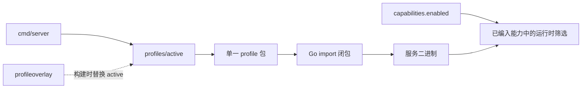
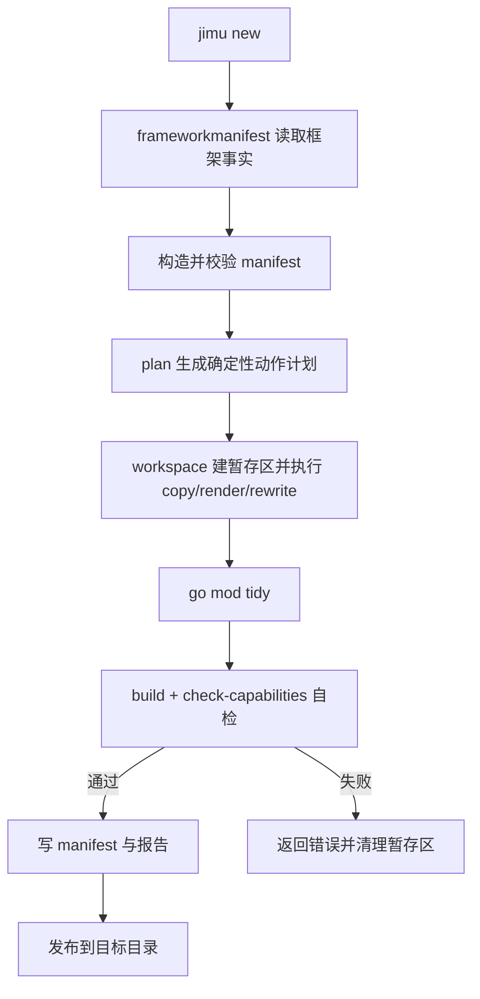
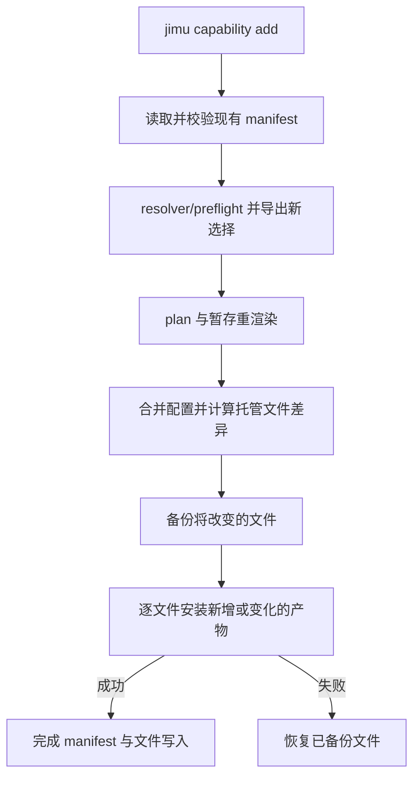

# 形态与项目生成设计

## 背景与范围

Jimu 在服务构建、进程启动和项目生成三个阶段选择代码。若把这些阶段视为同一种“启用能力”操作，会混淆二进制组成、运行时装配和生成项目的依赖边界。

本文区分 profile 构建、运行时装配和 `jimu new` 独立项目生成，并说明三者对依赖、驱动和资产的影响。具体成员从实现和生成结果获取，不在本文列出固定清单。

### 设计目标与非目标

设计目标：

- profile 以编译期组合控制服务二进制中的包和符号。
- 运行时配置只筛选已编入的能力，不改变构建依赖。
- `jimu new` 生成独立 Go module，由生成结果决定项目依赖。

非目标：运行时从网络下载或动态加载能力，以及把 profile 机制用作独立发布框架包的替代方案。

## 设计方案

### Profile：服务二进制组成

profile assembly 通过 Go import 图决定哪些能力包进入服务二进制。`internal/profiles/active` 只选择一个 profile，`cmd/server` 经该选点启动；`internal/profiles/registry` 供构建和检查工具查询完整 profile 清单，不由服务入口导入。构建工具通过 Go overlay 替换选点文件，不改仓库源码。

profile 还声明每项能力所选的驱动；`Descriptor.Drivers` 描述能力支持的驱动，profile 的 `assembly.Capability.Drivers` 描述当前构建选中的子集，并由 profile 的 blank import 注册。未编入的驱动不能在该二进制中启用。非代码资产的所有权和按 profile 选择规则由 `Descriptor.Assets` 与资产工具共同实现。

profile 不改变框架 `go.mod`。运行时 `capabilities.enabled` 只能筛选已编入且受门控的能力，无法增加 profile 外的包。profile 构成及依赖闭包由 `make profiles-check` 和能力门禁验证；文档不复制逐项组成清单。

### `jimu new`：独立 Go 项目

`jimu new <dir>` 按 `--profile` 或 `--with` 选择能力并生成独立 Go module。生成器会根据声明闭包和必要的 schema/编译依赖，复制或渲染源码、配置、驱动与资产，随后整理生成项目的 module 依赖。这里的 `--profile` 是生成预设（`minimal`/`auth`/`full`），不是框架内部构建形态；生成项目拥有自己的 `go.mod`，因此可以随选择收缩依赖。

对外产品入口只保留预设：`--profile=minimal|auth|full` 是正式选择器，不传选择器时默认 `minimal`；`--with` 只提供 experimental 专家组合，manifest 记录 `support: experimental`。脚手架 CLI 不再暴露框架内部 profile；`minimal`/`full` 同名值按官方预设解释，不选择内部 profile。保留的内部 profile 只有 `full`（开发、测试和 demo 的全量形态）与 `minimal`（冻结，仅保持构建和闭包门禁）；`enterprise`、`machine`、`saas` 已按 [ADR 0007](../adr/0007-profiles-are-internal-build-shapes.md) 退役。内部 profile 不等于产品预设。预设、预算、支持级别和兼容窗口的机器可读事实源是 [`docs/templates/v1`](../templates/v1/README.md)，实现门禁和生成器不得另建第二份选择集定义。

官方模板是可再生成一次的起始基线，不是持续管理的投影。生成后的工程归用户所有；`.jimu/manifest.json` 只记录来源、选择集和摘要，不授予 Jimu 覆盖用户文件的权利。v0.5.0 不提供隐式升级；v0.6.0 起提供显式 `jimu upgrade`，只在无冲突时修改生成器管理文件，并在备份后执行 tidy/build/test，失败按原字节回滚。schema v1 仍 fail-closed，也不提供自动项目/存量数据库迁移；v0.4.x 生成项目仍只支持“重新生成 + 人工迁移”，v0.5 的 schema v2 项目可通过显式 `jimu upgrade` 升级。升级支持窗口固定为 `v0.5.0` 起的 certified 模板，安全修复只保证当前 0.7.x 的最新 patch；决策见 [ADR 0003](../adr/0003-upgrade-support-window.md)。

三个预设都从**当前主代码仓库**按 import 闭包裁剪，而不是维护独立的模板树：

- `minimal` — 0 能力，只保留最小内核。`internal/platform`/`internal/shared`/`config`/`contract` 都不依赖能力，唯一耦合点曾是与能力 domain 共享的种子模型，现已抽到 `internal/platform/seedmodel`。生成项目不含数据库/Redis 客户端、`internal/e2e` 与 `docker-compose.yml`，配置也不含 `db`/`redis` 段；`go build`、`go test`、`go run` 都不需要外部服务，`GET /api/v1/ping` 由内核提供。
- `auth` — `user` + `access` + `auth`（含 `tenant` 编译闭包），支持级别 `certified`。生成 MySQL/Redis 客户端与迁移，但不生成 Compose：数据库由使用者提供，连接信息走 `DB_*`/`REDIS_*` 环境变量。
- `full` — 全部 24 个能力 + 完整驱动集（`s3`/`local`、`kafka`/`rabbitmq`/`redis`、`cache:redis`/`cache:memory`、`excel`/`csv`），支持级别 `validated`。`--with` 的缺省驱动只取首个，无法表达完整驱动集，因此 `full` 改成从 `internal/profiles/full/assembly.go` 派生。

预设只是裁剪起点：manifest 记录 `selection.template`，但 `jimu capability add` 只拒绝已退役的 `basic-api`/`auth-api`，预设项目可以继续加能力。由已退役模板生成的项目执行 `jimu upgrade` 直接硬失败（`ErrRetiredTemplate`），不提供迁移命令。

预设的门禁按「需不需要 Docker」分工，避免重复执行：

- `CI (PR)` 的 race 分片跑 `TestPresetBudgets`（读 `budgets.json` 实测 minimal/auth/full 三份生成树）与 `TestMinimalPresetStartsWithoutDependencies`（两种 env 下起真实进程验 `/livez`、`/readyz`、`/api/v1/ping`）。它们不需要 Docker，因此每个 PR 都有覆盖 —— 包括不触发 `CI (Scaffold)` 的 `feature/*`。
- `make test-scaffold-official`（`CI (Scaffold)` 的 official 档）**只跑** `TestAuthPresetEmptyDatabaseEndToEnd`：它需要裸 MySQL/Redis 容器，race 分片里 `requireHeavyMatrix` 会直接 skip，只能在这里跑。把前两条也放进来会让同一条用例在两个 workflow 各跑一遍（实测 +44s，CI 放大后约 +170s）。

`make test-scaffold-matrix` 保留为 full 档，继续覆盖全部 `--with` 与内部 profile 的生成/构建/测试选区，在手动触发或夜间定时运行。

官方门禁仍是 `release/*` 与 `dependabot/*` → `master` PR 的必需检查；full 只允许 `workflow_dispatch` 与夜间定时，不回到每个 PR。full 在全部 `--with`/内部 profile 选区之外增加固定、代表性的 pairwise 组合清单和 v0.5 upgrade fixtures。组合清单不遍历全幂集：每个用例最多请求两个代表性能力加必要的受保护中间件提供方，预算最多 10 个生成项目、2 个 CI shard，每个项目只做 build/vet，不承诺组合级 E2E；清单与上限的唯一事实源是 [`composition_matrix_test.go`](../../tools/generator/composition_matrix_test.go)。CI 的每个 shard 把耗时写入 step summary；显式运行时测试必须报告 `PASS`，`SKIP` 视为门禁失败，避免 full 在 CI 中静默跳过。

生成器从框架读取能力、profile、contract 和资产信息的唯一适配层是 [`tools/generator/frameworkmanifest`](../../tools/generator/frameworkmanifest)。适配层导出校验后的 manifest；计划、渲染、文件工作区和报告逻辑消费 manifest，不直接依赖框架内部包。唯一例外是叶子包 [`internal/capability`](../../internal/capability)：它只 import `internal/contract`，提供组合 resolver 与结构化诊断，不携带能力、形态或资产事实；`preflight` 复用该包以保持生成器与 `jimu check` 同一套组合规则。

manifest 记录项目选择、复制与模板动作、合并和重写规则、资产、测试裁剪、生成文件及摘要；它也是识别生成产物和 `jimu capability add` 增量更新的依据。schema v3 在 schema v2 的 provenance 字段（`framework.version`、`framework.commit`、`framework.dirty`、官方模板的 `selection.template_version`、`generated_file_sha256`）之外持久化组合结果：`composition.contract_version`、`requested`、`resolved`、`auto_added`、驱动选择、`validity` 与 `support`。`composition` 是升级与诊断的事实来源，`--dry-run` 与 `jimu check` 的 support 也读取该字段；组合状态的完整定义见[能力组合](capability-composition.md)。生成时只写 `validity: valid`，支持级别使用 `certified|validated|experimental`，内部 profile 统一映射为 `experimental`。schema v2 只读：加载时先按 v2 校验 digest，再在内存中确定性地补齐 `composition`（declared 集即 requested/resolved，无 auto-added，驱动取自 `selection.drivers`）并换为 v3；v2 只可能在预检通过后写出，因此推导 `validity: valid`，需要当前合法性时应重新运行 resolver。writer 拒绝 v2，schema v1 继续 fail-closed。commit 只通过 `git rev-parse --verify HEAD^{commit}` 从框架根解析，因此普通 clone 与 linked worktree 使用同一路径；解析或 dirty 检查失败时在写目标前终止。生成文件哈希在 tidy、自检和配置合并后计算，排除 manifest 与报告自身。更新能力时，生成器根据新的选择重算产物，并保留受支持的用户配置合并规则。

项目先写入暂存目录，再执行依赖整理、构建和能力门禁自检；通过后才发布到目标路径。失败时清理暂存内容。`make check-templates` 检查生成模板与当前框架结构的一致性。

生成前由组合 resolver 校验硬依赖、冲突、端口、驱动、迁移 schema 依赖、表/迁移、运行时服务/配置、中间件与 plan；诊断统一输出 `code`/`capability`/`path`/`message`/`fix` 并稳定排序，任一非法组合在创建暂存目录前终止，因此不会写目标目录。固定解析顺序和错误码见[能力组合](capability-composition.md)。`jimu check <dir>` 对已有项目的 `.jimu/manifest.json` 复用同一预检，并进一步报告受管文件漂移、当前/目标版本、升级可用性和下一步命令；`--deep` 只在私有临时副本中运行配置、build 和 test。`--with` 与模板路径都经过该预检，且 `--with` 仍标记 `support: experimental`。

### 新建项目流程

### 增量追加流程

新增能力复用与 `jimu new` / `jimu check` 相同的组合 resolver 和 preflight：硬依赖必须已经在项目装配集中，不会静默追加依赖；冲突、端口、驱动、迁移、运行时配置和中间件问题都在创建暂存目录或写目标文件前失败。组合结果保留既有 `requested` / `auto_added` 与驱动选择，并以 schema v3 `composition` 写回。未使用 `--force` 且项目 manifest 摘要已变化时，追加操作拒绝继续。

更新仅安装生成器管理的差异文件，并保留现有配置值；落盘复用 `jimu upgrade` 的 manifest 事务：先备份所有受影响文件，逐文件安装，manifest 最后写入，任一失败按原字节恢复。该增量追加流程不执行新建项目使用的 `go mod tidy` 和构建自检，支持级别保持 `experimental`。预设项目是裁剪起点，可以继续 `capability add`；只有已退役的 `basic-api` / `auth-api` 项目会被拒绝。

### 显式升级规划

`jimu upgrade` 是独立的显式升级入口，不复用 `capability add` 或隐式重生成。规划阶段只读：读取现有 manifest（schema v2 在内存升级为 v3），按 `selection.template`、`selection.profile` 或 `composition.requested` 重建当前框架下的目标 manifest；`--with` 项目同时透传 `composition.drivers`，保留非默认驱动选择。随后把目标产物渲染到系统临时目录；项目已有 `docs/profiles/generated-report.md` 时，在同一暂存树重算报告并纳入比较。规划器比较三份事实：manifest 的 `generated_file_sha256` 基线、项目当前文件、目标模板产物（含重算后的报告）。

| 分类 | 判定 | 动作 |
|---|---|---|
| `untouched` | 本地与目标都等于基线（或本地已与目标一致） | 不安装 |
| `modified` | 本地等于基线，目标模板变化 | 安装目标产物 |
| `conflict` | 本地偏离基线（修改、删除、路径被非普通文件占用），或目标新增路径已被本地文件占用 | 保留本地，报告路径和原因 |
| `new` | 目标模板新增，本地不存在 | 安装 |
| `deleted` | 目标模板不再生成基线文件；本地副本保持原状，不自动删除 | 不安装、不删除 |

`--dry-run` 输出完整分类报告；`--check` 复用同一报告，存在 `conflict` 时退出非 0。两者都不写项目目录，临时目录中的目标渲染和 `go mod tidy` 在报告结束后清理。`--json` 从同一报告输出稳定 schema `v1`；`--diff` 物化 local→target 文本差异，二进制只保留元数据。两个 flag 只允许用于只读模式。

### 显式升级事务

不带 `--dry-run` / `--check` 的 `jimu upgrade` 执行写入事务：先按规划器结论拒绝冲突，再把每个将改变的路径（含 manifest，以及可能被 tidy 改写的 `go.mod`/`go.sum`）备份到项目外的临时目录；随后逐文件安装目标产物，受支持配置在暂存副本里以项目现有段值为底合并。安装完成后在同一项目上执行 `go mod tidy`、`go build ./...` 与 `go test ./...`（`--no-tidy` 只跳过规划临时副本的 tidy，不跳过这里的验证）；任一安装、验证或 manifest 写入失败都按原字节恢复所有已触碰文件并删除本次新增的空目录。

验证通过后才写入新 manifest：重新计算 `generated_files` 的最终哈希（覆盖 tidy 产生的变化），记录当前框架 provenance 与组合块，并重新计算 digest。文件与 manifest 都没变化时事务不做任何写入，也不重复跑验证。`conflict` 绝不静默覆盖；`deleted` 不自动删除用户目录中的文件，只从后续 manifest 基线中移除。

升级发布门禁不再依赖固定的 v0.5 快照：模板退役后无法再用旧模板渲染目标树，`tools/generator/upgrade_fixture_test.go` 改为现场生成 `auth` 预设作为 fixture，覆盖 untouched、用户修改判冲突、用户自有文件保留、用户删除、模板删除、重复升级和验证失败回滚。`TestUpgradeRejectsRetiredTemplates` 单独钉住旧模板的硬失败路径。`make test-scaffold-upgrade` 运行该门禁，完整 `make test-scaffold-matrix` 也包含它。

## 关键决策

- **profile 不负责缩小框架 `go.mod`。** 它通过 Go import 图改变服务构建闭包；真正拥有独立依赖清单的是 `jimu new` 生成的项目。
- **运行时开关不能补入未编译代码。** `capabilities.enabled` 只控制当前 profile 已编入的能力集合，保持构建期和运行期职责清晰。
- **生成器通过 manifest 适配框架事实。** 仅 `frameworkmanifest` 读取框架内部结构，生成步骤消费校验后的 manifest；`internal/capability` 作为只依赖 contract 的叶子例外，提供共享的组合 resolver/诊断。内部包调整的影响集中在适配层与这个叶子包。
- **生成结果先验证再发布。** 暂存目录承载依赖整理、构建和能力门禁自检；验证通过后才写入目标路径。
- **Manifest 是生成计划和更新识别的共同契约。** 计划不直接探测框架包；manifest 校验动作有效性后，渲染层执行它描述的操作。这样读取框架内部事实与写文件事务能分别测试。
- **增量更新只管理已生成文件。** manifest 保存生成文件集合、摘要与合并规则，更新对受管理产物计算变更；这保留受支持的配置合并，同时为覆盖风险提供显式 `--force`。
- **官方模板与内部 profile 是两套产品契约。** 模板定义对外承诺、硬预算和端到端验收；profile 仍只描述 Jimu 服务二进制的编译期组成。两者可共享能力声明，但不能互相替代。

## 约束与不变量

profile 选择必须只通过 active 选点进入服务构建；registry 留在工具侧。生成器读取框架内部事实只经 `frameworkmanifest`（以及只依赖 contract 的 `internal/capability` 叶子包），其余生成逻辑消费 manifest。服务 profile 不改变框架 `go.mod`；只有独立生成项目可以整理自身依赖。默认 CLI 路径执行自检，绕过自检的选项只留给受控测试调用方。更改组成或复制规则时同步更新对应门禁和本文，不在 README 重复内部裁剪算法。

## 实现映射

- Profile：[internal/profiles](../../internal/profiles)、[tools/profileoverlay](../../tools/profileoverlay)
- 项目生成：[tools/generator](../../tools/generator)、[frameworkmanifest](../../tools/generator/frameworkmanifest)
- 契约与事务：[manifest model](../../tools/generator/manifest/model.go)、[manifest validation](../../tools/generator/manifest/validate.go)、[workspace staging](../../tools/generator/workspace/stage.go)
- 升级规划与事务：[upgrade classifier](../../tools/generator/upgrade/classify.go)、[upgrade facade](../../tools/generator/upgrade.go)、[workspace transaction](../../tools/generator/workspace/upgrade.go)
- 增量追加：[add facade](../../tools/generator/add.go)、[framework manifest export](../../tools/generator/frameworkmanifest/export.go)、共享 [workspace transaction](../../tools/generator/workspace/upgrade.go)
- 验证：`go test ./tools/generator/...`、`jimu check <generated-dir>`、`jimu upgrade <generated-dir> --dry-run`、`make profiles-check`、`make check-capabilities`、`make test-scaffold-official`、`make test-scaffold-composition`、`make test-scaffold-upgrade`、`make test-scaffold-matrix`
- CLI 参数和操作示例见 README「[生成项目](../../README.md#生成项目jimu-new--jimu-capability-add)」；能力声明和运行时装配见[能力架构](capability-architecture.md)。
