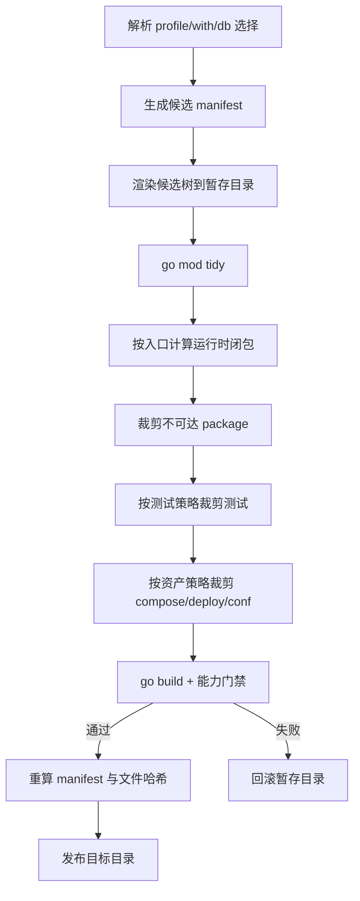

# v0.13.0 minimal 生成项目精简设计

> 状态：已确认（2026-11-12）
> 日期：2026-11-12
> 范围：`jimu new` 的 `minimal` 产物裁剪、生成参数、manifest 持久化与升级兼容

## 1. 背景与问题

`jimu new --profile=minimal` 当前生成的是 **0 能力、0 驱动的可运行 HTTP 服务**，但它
仍然携带大量与 `minimal` 运行时无关的代码、测试和资产。以 2026-11-12 的样本项目
`/Users/king/Documents/Projects/Mine/work/test` 为事实依据：

| 指标 | 当前值 |
|---|---:|
| 文件总数 | 222 |
| Go 文件 | 178 |
| 测试文件 | 74 |
| 测试代码行数 | 7638 |
| Go package | 41 |
| `cmd/server` / `cmd/cli` 运行时可达 package | 27 |
| 加上 tools 后可达 package | 33 |
| 运行时不可达 package | 8 |
| `go.mod` 直接依赖 | 23 |
| `go list -m all` 模块数 | 201 |

运行时不可达的 8 个 package 是：

- `internal/platform/db`
- `internal/platform/breaker/db`
- `internal/shared/dbpurge`
- `internal/shared/id`
- `internal/shared/pagination`
- `internal/shared/sqlpattern`
- `internal/shared/testutil`
- `internal/shared/validator`

这些 package 仍会被 `go build ./...` 和 `go test ./...` 编译，因此会继续占文件数、
编译时间和 `go.mod` 依赖。与此同时，`tools/checkcapabilities`、`tools/logcheck`、
`internal/capabilities/catalog`、`internal/profiles/registry` 和 17 个部署资产文件也
被无条件带入 minimal。

根因不是生成器缺少能力裁剪，而是：

1. 能力目录按选择裁剪，但**内核代码仍按手工目录清单整体复制**。
2. 测试文件没有被纳入运行时闭包判断；所有被复制 package 的测试都会进入产物。
3. tools、deploy、conf 和 CLI 命令没有独立的生成选项。
4. `includeDatabase` 只裁剪 app/config/migration，没有裁剪 `internal/platform/db`
   这个 DB kernel package 本身。

现有设计
[按裁剪生成项目](../specs/2026-11-06-project-generation-by-pruning-design.md)
已经确定“`minimal` = 0 能力 + 闭包裁剪后的最小内核”，但当前实现尚未把“内核闭包裁剪”
落到代码复制层。本设计补齐这一层，并把可裁剪范围参数化。

## 2. 意图与成功标准

### 2.1 意图

让 `minimal` 的“最小”从**能力集最小**变成**运行时闭包最小**：

- 生成项目中每个非测试 Go package 都能从 `cmd/server`、`cmd/cli` 或显式保留的工具根
  到达。
- 没有被运行时引用的 DB、测试辅助、能力查询工具和部署资产默认不进入 minimal。
- 用户仍可通过 `jimu new` 参数显式找回测试、工具和部署资产。
- 生成、升级和能力追加都保持可复现，不静默删除用户文件。

### 2.2 成功标准

`minimal` 生成结果必须同时满足：

- `go build ./...`、`go test ./...`、`go mod tidy` 后无差异。
- `cmd/server` 可启动，`/livez`、`/readyz`、`/api/v1/ping` 可用。
- `go list ./...` 中每个 package 都至少属于运行时、测试、工具或资产闭包；不存在只被
  历史模板或已删除入口引入的 package。
- `go list -deps ./cmd/server ./cmd/cli` 不包含 DB、Redis、测试辅助和 unused shared
  package。
- manifest 能记录本次生成选项；`jimu upgrade` 能按同一选项重建。
- `full` 仍然包含全部能力、完整工具和观测栈；`auth` 仍然包含 DB/Redis、能力门禁
  和裁剪后的 `docker-compose.yml`。

不把“文件数必须低于某个固定值”作为硬编码验收。硬编码数字会随能力和模板变化，
验收应使用闭包和不变量，而不是脆弱的总数。

### 2.3 非目标

- 不重写 `internal/assembly` 的组合根语义。
- 不在本版本移除 `internal/capability` 的能力解析算法。
- 不把 minimal 改成手写模板树。
- 不删除用户已有生成项目中的文件；升级只更新 manifest 基线。
- 不改变 `--profile=minimal|auth|full` 和 `--with` 的能力选择语义。
- 不把 DB、Redis 或 OTel 变成独立的布尔开关；它们仍由能力和驱动选择派生。

### 2.4 反目标

- 为了减少文件数而删掉运行时需要的 package，导致 `go run` 或能力装配失败。
- 通过删除所有测试让 `go test ./...` 空跑通过。
- 让 tools、tests、deploy 的默认值随文件数临时变化，导致同一 manifest 无法复现。
- 在 `jimu upgrade` 中静默删除用户项目里的文件。

## 3. 不变量与约束

### 3.1 运行时闭包优先于目录清单

生成项目的代码复制集必须由入口闭包决定，不能继续用手工 `kernelDirs`/exclude 列表
推断内核。手工列表可以继续描述候选目录，但最终保留集必须经过 `go list -deps` 或
等价 package graph 验证。

### 3.2 三类闭包分离

生成器必须区分：

| 闭包 | 根 | 用途 |
|---|---|---|
| 运行时闭包 | `cmd/server`、`cmd/cli`、显式 tools | 决定生产 Go package |
| 测试闭包 | 保留 package 的 `_test.go`、能力测试 | 决定测试文件，不反向拉入运行时 package |
| 资产闭包 | `Descriptor.Assets`、内核资产组、`--deploy` | 决定 compose/YAML/Helm/K8s/conf 等非 Go 文件 |

测试闭包和资产闭包都不能扩大运行时闭包。`go test ./...` 通过不能成为保留
运行时无关 package 的理由。

测试闭包允许保留“只被测试使用”的 package，但该 package 的非测试文件不得 import
已被裁掉的运行时 package。以 `internal/shared/testutil` 为例：它的 `testdb.go`
import `internal/platform/db`，所以 minimal 裁掉 DB 时 testutil 也必须一起裁掉，
引用它的测试一并删除；auth/full 保留 DB 时 testutil 才可以保留。

### 3.3 多平台构建标签

单平台 `go list` 会漏掉只在 `_windows.go`、`_linux.go` 或其他 build tag 下 import 的
package。闭包计算必须至少覆盖生成项目承诺支持的 `GOOS/GOARCH` 组合，或保守地取
所有 supported build tags 的并集。不能因为当前机器是 darwin/linux 就裁掉 Windows
运行时需要的 package。

### 3.4 生成期 fail-closed

裁剪后必须重新执行：

1. `go mod tidy`
2. `go build ./...`
3. 生成项目自带或框架侧的能力门禁
4. manifest 文件哈希重算

任一步失败都回滚暂存目录，不发布半成品。

### 3.5 升级与用户文件

新选项必须写入 manifest。`jimu upgrade` 以 manifest 为基线，不因新默认值删除用户
已有文件，也不改变 generation 选项；从旧 manifest 升级时按旧默认值解释。用户若要
变更生成选项，应重新运行 `jimu new --force`。

## 4. 目标模型

### 4.1 生成流程



第一版采用**先生成候选树、再在暂存目录做闭包裁剪**的路径。它比在框架仓预计算
overlay 闭包多一次 `go list`，但事实来源就是即将发布的树，最容易和真实构建结果
保持一致。预计算闭包作为后续性能优化，不改变本设计的验收口径。

### 4.2 代码裁剪算法

1. 按现有能力裁剪规则生成候选树。
2. 在暂存目录执行 `GOWORK=off go list -deps ./cmd/server ./cmd/cli`。
3. 若 `--tools` 保留工具，把工具入口加入根集合。
4. 对每个 supported `GOOS/GOARCH` 重复上一步，取并集。
5. 得到运行时保留集 `runtimeKeep`；能力目录、配置文件、资产和 manifest 不参与
   Go package 删除判断。
6. 若 `tests != none`，按测试策略选出测试根，计算 test-only 依赖闭包。test-only
   package 只有在它的非测试文件不 import 被裁运行时 package 时才允许保留；它不加入
   `runtimeKeep`，也不影响运行时验收。
7. 最终保留集 = `runtimeKeep` ∪ 允许的 test-only package。
8. 删除候选树中不在最终保留集的模块 package 目录。
9. 重新 `go mod tidy`，确认依赖图收敛。

不得直接删除 `internal/capabilities/<name>` 中选中能力目录：能力目录由现有 Selection
结果决定，闭包裁剪只处理“已复制但没有入口引用”的 kernel/shared/tool 目录。

### 4.3 测试裁剪算法

测试策略是独立参数，不与运行时 package 删除混在一起：

- `selected`：保留运行时保留 package 的测试，以及选中能力目录的测试；删除引用了
  已裁 package 的测试。复用并扩展现有 `pruneUnsatisfiableTests` 的 import 判定。
- `all`：保留 retained package 中所有**可满足**的测试；`all` 不重新引入被裁掉的
  运行时 package。引用已裁 package 的测试仍删除。
- `none`：不复制框架测试；生成项目仍保留 `go test ./...` 入口，结果为空。

因此 minimal 的 `tests=all` 也不是“框架全量测试”：它不能保留需要
`internal/shared/testutil` / `internal/platform/db` 的测试，否则会把 DB package
重新拉进 `go build ./...`。`selected` 是 minimal 默认值。测试删除后必须实际运行
`go test ./...`；任何仍引用被裁 package 的测试都视为生成错误，而不是静默跳过。

### 4.4 工具裁剪

工具不参与生产二进制，但会影响 make 目标和生成期自检：

| 模式 | 内容 | 默认 |
|---|---|---|
| `auto` | 0 能力只保留 `logcheck`；有受门控能力时保留 `logcheck + checkcapabilities` | 是 |
| `all` | `logcheck + checkcapabilities + profileassets + heavydeps` | 否 |
| `none` | 不复制 tools，也不生成对应 make 目标 | 否 |

`tools=none` 时，`jimu new` 的生成期自检仍必须执行框架侧 preflight 和 `go build`；
只是不把工具复制到最终项目。`internal/capabilities/catalog` 和
`internal/profiles/registry` 仅保留到“有工具或测试闭包实际引用”为止。

manifest 同时记录用户模式（`tools_mode`）和解析后的实际工具（`tools_resolved`），
以便 `capability add` 在能力集变化后重新计算 `auto`，而不是把旧的解析结果当成用户
显式选择。

### 4.5 部署与 conf 裁剪

`deploy` 指完整部署面，不只是 `deploy/` 目录。它包含 compose 入口、Dockerfile、
目标清单、观测资产和部署脚本；不包含业务配置 `configs/`、权限模型 `conf/`，也不
包含 CI、测试和其他开发脚本。

compose 文件不是根仓库文件的原样复制：生成时按项目名、形态和运行时服务裁剪，去掉
构建期 `PROFILE` 参数，卷名和镜像名使用项目标识。无 MySQL 不生成
`mariadb`/`jimu-init`，无 Redis 不生成 `redis`；观测栈只在 `observability` 组件
被选中时出现。

`--deploy` 不是单一枚举，而是可组合的部署目标集合：

| 取值 | 生成内容 |
|---|---|
| `none` | 不生成 compose 和 `deploy/` |
| `compose` | `deploy/compose/docker-compose.yml`、`deploy/backup`、`deploy/scripts` |
| `k8s` | `deploy/k8s/` 基础清单；MySQL 时附备份 Job |
| `helm` | `deploy/helm/` 基础 Chart；MySQL 时附备份模板 |
| `observability` | `deploy/observability/` 共享资产；选中目标时附对应接线 |
| `all` | `compose,k8s,helm,observability` 的并集 |

可写成逗号集合，例如：

```text
--deploy=none
--deploy=compose
--deploy=compose,observability
--deploy=k8s,helm
--deploy=all
```

`backup` 不是独立开关：选中任一目标且运行时需要 MySQL 时自动带上该目标的备份
资产。`observability` 单独选择只生成共享资产；与 `compose`/`k8s`/`helm` 组合时
才生成对应接线。默认值：minimal `none`、auth `compose`、full `all`、
`--with` `all`。

`compose`/`k8s`/`helm` 任一被选中时，同时生成 `deploy/docker/Dockerfile`；`none`
和仅 `observability` 不生成。Docker build context 仍是项目根目录，Makefile 使用
`docker build -f deploy/docker/Dockerfile -t ... .`，因此 `COPY . .` 的相对路径
不变。

`deploy/` 目录同步调整为按目标分组，观测资产不再散落在各目标根目录：

```text
deploy/
  docker/
    Dockerfile
  compose/
    docker-compose.yml
    compose.observability.yml
  k8s/
    *.yaml
    observability/*.yaml
  helm/
    Chart.yaml
    values.yaml
    templates/*.yaml
    templates/observability/*.yaml
  observability/
    openobserve/
      alerts/
      dashboards/
      *.sh
    otel-collector.yaml
  backup/
    Dockerfile
  scripts/
    init-secrets.sh
    backup.sh
    restore.sh
    db_common.sh
    install_db_clients.sh
    observability.sh
```

`deploy/compose/` 是 compose 的唯一事实源，根目录不再生成
`docker-compose.yml`/`compose.observability.yml` 副本。Makefile 和运维脚本显式使用
`-f deploy/compose/docker-compose.yml`，需要观测栈时再叠加
`deploy/compose/compose.observability.yml`；compose 内部引用 `deploy/scripts` 和
`deploy/observability`，不再引用根 `scripts/` 或散落的 `deploy/openobserve`、
`deploy/otel-collector.yaml`。

Observability 不再由 `full` 形态旁路控制，而是 `observability` 组件：`full` 和
`--with` 默认 `all`，`auth` 可通过 `--deploy=compose,observability` 或
`--deploy=all` 打开观测栈。

`backup` 是 `ops` 内核资产组的一部分，只在运行时需要 MySQL 时进入所选目标；
`observability` 只在组件被选中时展开。`conf/rbac_model.conf` 仍归入 auth/access
资产：没有相关能力时不生成。`configs/` 由现有 section merge 控制；`id`、
`ratelimit.tenant`、`http_client` 等段是否保留，跟随运行时服务或能力闭包，不单独
增加开关。

### 4.6 CLI 与 Makefile

minimal 默认只生成无 DB 的 CLI 命令：`version`、`config check`。有 DB 能力时保留
`migrate`/`seed`，并同步保留 Makefile 对应目标。无 DB 时不再生成 no-op 的
`migrate up/down/status/redo` 和 `seed`。

CLI 命令集仍由 DB 闭包派生，不增加 `--cli=none|minimal|full` 这种命令集枚举。
新增的 `--cli=both|direct` 只控制是否把 TUI 编进生成项目，见 4.7。

`--with` 没有 profile，CLI 同样由 DB 闭包派生；minimal 和 `--with` 在无 DB 时都生成
不含 no-op 命令的 CLI。

Makefile 的 compose 目标由 `deploy` 派生：`none` 不生成；包含 `compose` 时生成
`up`/`down`/`logs`/`status`，统一使用 `-f deploy/compose/docker-compose.yml`；
包含 `observability` 时再增加 `up-observability`，叠加
`deploy/compose/compose.observability.yml`。备份目标只在包含目标且运行时需要
MySQL 时生成。

`image` 目标只在生成了 Dockerfile 时存在，统一使用
`docker build -f deploy/docker/Dockerfile -t ... .`；build context 保持项目根目录。

### 4.7 CLI 双模式：直接命令 + TUI

直接命令是脚本/CI 的稳定接口：现有 Cobra 命令、flag、stdout/stderr 和退出码保持
不变。TUI 是同一动作层的交互外壳，不替代直接命令。

入口规则：

| 场景 | 行为 |
|---|---|
| `jimu`，无参数且 stdout 是 TTY | 打开框架 CLI 首页 |
| `jimu tui` | 显式打开 TUI |
| `jimu new`，无目录且是 TTY | 打开新建项目向导 |
| `jimu new <dir> ...` | 直接生成，行为不变 |
| `jimu check` / `jimu upgrade` / `jimu capability add`，无必要参数且是 TTY | 打开对应向导 |
| `jimu ... --no-tui` 或 `JIMU_NO_TUI=1` | 强制直接模式 |
| 非 TTY、CI、重定向 | 永不启动 TUI；无参数时打印 help 或返回用法错误 |
| 生成项目 `./jimu`，无参数且是 TTY | 打开项目操作菜单 |

生成项目由 `--cli=both|direct` 控制：`both` 同时编入直接命令和 TUI，`direct` 只保留
直接命令。`auth`/`full`/`--with` 默认 `both`；`minimal` 默认 `direct`，避免把 TUI
依赖带回最小项目，需要时用 `--cli=both` 显式打开。

TUI 使用 `github.com/charmbracelet/bubbletea` v1.3.10、`lipgloss` v1.1.0 和
`bubbles` v1.0.0，代码隔离在 `internal/cli/tui`。`cmd/server` 不 import 该包，
因此 TUI 不进入服务端二进制。独立探针实测该组合约 36 个模块、4.5 MB 二进制
增量；这是 `minimal` 默认 `--cli=direct` 的原因。

框架 TUI 首页提供：新建项目、检查项目、升级项目、追加能力、版本/帮助。新建向导
覆盖目录、module、profile/`--with`、DB、tests、tools、deploy 集合和 dry-run；
检查/升级/追加能力只暴露对应直接命令已有的选项。生成项目菜单只显示该项目实际生成的
命令：`config check`、`migrate up/down/status/redo`、`seed`；无 DB 的 minimal 不显示
DB 菜单项。

动作层与界面层分离：

- `internal/cli/actions` 提供 `New`、`Check`、`Upgrade`、`AddCapability` 等函数，
  接收输入、输出 writer 和进度回调，不 import Cobra 或 Bubble Tea。
- Cobra 命令和 TUI 都调用同一动作层，保证参数校验、生成选项、manifest 和退出语义
  一致；TUI 不通过 shell 再调用自身。
- 生成项目只复制通用 TUI 壳和项目菜单，不复制框架专属的 `new`/`check`/`upgrade`
  动作；项目菜单直接调用生成项目已有的 CLI 动作。
- 长任务用 `tea.Cmd` 异步执行，支持 `ctrl+c` 取消并回滚生成目录；进度只追加到
  视口，不阻塞渲染。
- TUI 以 80x24 为最低可用尺寸，键盘操作。Lip Gloss 支持 ANSI 16/256/truecolor，
  按终端能力自动降级；`NO_COLOR=1`、非 TTY 或 `--no-color` 时输出纯文本。
- 颜色只用于层级和强调，不作为唯一状态语义：成功/失败/警告同时用文字和形状表达，
  主色使用蓝/橙/紫/灰，不只靠红/绿区分。

## 5. 参数模型

### 5.1 新增参数

| 参数 | 取值 | 默认 | 说明 |
|---|---|---|---|
| `--tests` | `selected` / `all` / `none` | `selected` | 测试裁剪策略 |
| `--tools` | `auto` / `all` / `none` | `auto` | 生成项目自带工具 |
| `--deploy` | `none`；`compose` / `k8s` / `helm` / `observability` 的逗号集合；`all` | profile 派生 | 部署面（compose + `deploy/`） |
| `--cli` | `both` / `direct` | profile 派生 | 生成项目 CLI 是否编入 TUI |

`--profile`、`--with`、`--shape`、`--module`、`--db`、`--report`、`--no-tidy` 的语义
保持不变。`--db` 仍选择方言，不新增 `none`；DB kernel 是否进入产物继续由
`includeDatabase` 和选中能力的 RuntimeServices 派生。

`--no-tui` 和 `--no-color` 是运行时开关，不是生成选项：前者只让本次执行走直接
模式，后者关闭 TUI/彩色输出，都不改变 manifest 中的 `cli` 配置。

### 5.2 profile 默认值

本设计的判断：

| profile | tests | tools | deploy | CLI |
|---|---|---|---|---|
| `minimal` | `selected` | `auto`（仅 logcheck） | `none` | `direct`，无 DB 命令 |
| `auth` | `selected` | `all` | `compose` | `both`，完整命令 |
| `full` | `selected` | `all` | `all` | `both`，完整命令 |
| `--with` | `selected` | `auto`（有能力时为 all） | `all` | `both`，由 DB 派生 |

这些默认值会改变 `minimal` 的产物，也会改变 `auth` 的部署面：`auth` 从“无
compose”变为默认生成裁剪后的 `docker-compose.yml`，但不改变能力选择。想要旧
minimal 的 tests/tools 且仍不生成部署面，可使用
`--profile=minimal --tests=all --tools=all --deploy=none`。

`observability` 组件现在是 Observability 的唯一开关：`full` 和 `--with` 默认
`all`，`auth` 想要观测栈时必须显式传 `--deploy=compose,observability` 或
`--deploy=all`，不再依赖 profile 名称。

### 5.3 manifest 持久化

新增 manifest `generation` 块，把解析后的选项和裁剪模式写死：

```json
{
  "generation": {
    "runtime_closure": true,
    "tests": "selected",
    "tools_mode": "auto",
    "tools_resolved": ["logcheck"],
    "deploy": [],
    "cli": "minimal",
    "cli_ui": "direct"
  }
}
```

`tools=auto` 在 manifest 中同时写模式和解析后的实际工具列表，保证 `capability add`
能重新计算，`upgrade` 能按用户模式复现。`deploy` 写排序后的组件数组，空数组表示
`none`；`cli` 是命令集（`minimal`/`full`），`cli_ui` 是 `direct`/`both`。
manifest schema 升到 v4；v3 读取时按旧行为补齐默认值：

```text
runtime_closure=false, tests=all, tools_mode=all,
deploy = v3 minimal ? [] : (v3 full ? [k8s,helm,observability] : [k8s,helm]),
cli = DB 选择存在 ? full : minimal,
cli_ui = direct
```

v3 没有 compose、TUI 和新目录结构，因此不能映射成新的 `all`。这样可以保证旧项目
升级时不会突然减少文件，也不会把旧项目误判为已经选择了 compose/TUI。具体字段命名
可以由实现者调整，但“模式与解析值都持久化”和“v3 按旧默认值读取”是必须满足的
约束。v3 minimal 的旧 CLI 是没有 DB import 的 no-op 版本，因此映射为
`cli=minimal`，不能映射为 `full`。

### 5.4 capability add 与 upgrade

`jimu capability add` 从 manifest 读取 `generation`，用新的能力集重新计算派生值：

- 保留用户显式模式：`tests`、`tools_mode`、`deploy`；
- 重新计算 `tools_resolved`、DB kernel、CLI 和 Makefile 目标；
- add 必须是单调增长；如果重算结果要求删除已有生成文件，生成器 fail closed，提示
  重新生成，而不是静默删除；
- 成功后把新的 `generation` 和文件哈希写回 manifest。

v0.13.0 不允许 `jimu upgrade` 修改 `tests/tools/deploy/cli_ui` 选项；upgrade 只按
manifest 中的 `generation` 重建，避免“缩容”时旧文件留在磁盘上导致 `go build ./...`
或 `go test ./...` 失败。用户若要改变生成选项，应重新运行 `jimu new --force`；
若后续需要原地重配置，再设计独立的 `jimu reconfigure`，并明确“只删除未修改的生成
文件”。

v3 项目的旧 `deploy/` 布局不在 `upgrade` 中原地搬迁：upgrade 不改 generation
选项，也不物理移动/删除旧资产；新目录结构只对新建的 v4 项目生效。需要新布局时
重新生成项目。这样可以避免把“升级”变成不可逆的文件搬迁。

### 5.5 `--no-tidy`

闭包计算前允许执行一次内部 `go mod tidy` 以得到可解析的模块图；这次 tidy 属于生成
流程本身，不受 `--no-tidy` 影响。`--no-tidy` 只跳过裁剪完成后的最终 tidy 写回，
不跳过闭包计算、`go build` 或能力门禁。如果 `go list`、build 或门禁失败，生成仍
整体回滚。

## 6. 分阶段实施

### Phase 1A：运行时闭包裁剪

- 在暂存目录实现多 GOOS/GOARCH 的 package 闭包裁剪。
- 删除运行时不可达的 DB/test-only/shared package。
- 新增 `--tests`、`--tools`，定义 `--with` 的默认值。
- minimal 默认移除 DB kernel、unused shared、checkcapabilities 和
  `conf/rbac_model.conf`；`capability add` 重新计算 `auto` 派生值。
- manifest v4 记录 generation 选项；v3 读取兼容。
- `upgrade` 保持 manifest 中的 generation 选项，不接受缩容式选项变更。

### Phase 1B：deploy 组件化与目录重排

- 新增 `--deploy` 组件集合；auth 默认 `compose`，full / `--with` 默认 `all`。
- 重排 `deploy/`：观测资产收进 `deploy/observability/`，脚本收进
  `deploy/scripts/`，Dockerfile 收进 `deploy/docker/`，k8s/helm 的观测清单进入
  各自 `observability/` 子目录。
- 根 compose 移入 `deploy/compose/`，Makefile、运维脚本和文档统一改为显式 `-f`。
- 同步更新资产归属表、生成器 rewrite 路径、compose volume 和 Makefile 目标。
- 条件化 CLI/Makefile 的 DB 命令、compose 目标和观测目标。
- v3 旧布局不在 upgrade 中搬迁，新布局只对新建 v4 项目生效。

### Phase 1C：CLI 双模式（TUI + direct）

- 新增 `--cli=both|direct`；框架 CLI 默认双模式，minimal 生成项目默认 direct。
- 引入 Bubble Tea + Lip Gloss + Bubbles，新增 `internal/cli/actions` 动作层。
- 实现框架 TUI 首页和 new/check/upgrade/capability 向导，以及生成项目菜单。
- 保证非 TTY 自动回退、`--no-tui`/`JIMU_NO_TUI=1` 和直接命令输出不变。
- 更新 README、`docs/design/profiles-and-project-generation.md` 和
  `docs/releases/v0.13.0.md`。

### Phase 2：能力边界细化

- 按能力裁剪 `internal/contract` 中明确的能力专用文件。
- `middleware/admin_auth.go`、`middleware/signature.go` 按能力选择。
- `assembly/portflow.go` 只保留给测试/探针；生成项目默认不复制。
- 评估 CLI 命令集的显式裁剪和配置 section 的显式裁剪。

### Phase 3：零能力架构收敛

- 评估是否为零能力项目生成固定 assembly，移除 `internal/capability`、catalog 和
  registry。
- 用 overlay/预计算替代“生成后剪枝”，减少一次候选树写入。
- 将 `internal/contract` 拆成 core/auth/queue/admin 等子包。

Phase 3 是独立的架构收益，不阻塞 v0.13.0 的 minimal 瘦身。

## 7. 验证与门禁

### 7.1 生成器单测

- 用 fixture 构造“可达 package + 不可达 package + 不可达测试”，断言裁剪结果。
- 断言不同 `GOOS/GOARCH` 的 build-tag 入口并集不会被误删。
- 断言 `tests=none` 不会留下引用已裁 package 的测试。
- 断言 `tests=all` 不会把被裁的 runtime package 拉回来，不可满足的测试会被删除。
- 断言 `tools=none` 不生成 make 目标，生成期自检仍执行框架侧 preflight。
- 断言 `deploy=none` 不生成 compose 和 `deploy/`；`compose`、`k8s`、`helm`、
  `observability` 各自只生成自己的文件；`all` 是四者并集。
- 断言 compose 只生成在 `deploy/compose/`，根目录不再出现
  `docker-compose.yml`/`compose.observability.yml` 副本。
- 断言包含 `compose`/`k8s`/`helm` 时生成 `deploy/docker/Dockerfile`，`none` 和
  仅 `observability` 不生成；Dockerfile 缺失时 Makefile 不生成 `image` 目标。
- 断言 compose 的 `build.dockerfile` 指向 `deploy/docker/Dockerfile`，build context
  仍是项目根目录。
- 断言新目录结构：观测资产在 `deploy/observability/`，脚本在 `deploy/scripts/`，
  `deploy/k8s/observability/` 与 `deploy/helm/templates/observability/` 不再使用
  旧的散落路径。
- 断言 compose 按运行时服务裁剪：无 MySQL 不出现 `mariadb`/`jimu-init`，无 Redis
  不出现 `redis`；Observability 只由 `observability` 组件打开，不受 profile 旁路
  影响。
- 断言无 DB 项目的 Makefile 不生成 DB 目标；包含 `observability` 才生成
  `up-observability`；包含 `compose` 才生成 compose 目标。
- 断言 manifest v3 读取时得到旧默认值，v4 写入后升级可复现。
- 断言 v3 minimal 映射为 `cli=minimal`、`deploy=[]`，不会把 DB kernel、compose 或
  TUI 带回。
- 断言 `--cli=direct` 的生成项目不含 Bubble Tea import；`--cli=both` 含 TUI，
  且 `cmd/server` 的依赖闭包不包含 TUI 包。
- 断言 TUI 与直接命令对同一输入产生相同的 generator options、manifest 和校验错误。
- 断言非 TTY、`--no-tui`、`JIMU_NO_TUI=1` 不会启动 TUI；直接命令的输出和退出码
  不变。
- 断言 `NO_COLOR=1`、`--no-color` 和非 TTY 输出不含 ANSI 转义；支持颜色的终端
  走 Lip Gloss 的 ANSI/truecolor 降级链。
- 断言 `--with` 的默认 `tests/tools/deploy` 与无 profile 场景一致。
- 断言 `capability add` 能重算 `tools_resolved`，且不会要求删除已有文件。

### 7.2 生成物验收

至少覆盖：

```text
jimu new /tmp/minimal --profile=minimal
jimu new /tmp/minimal-tui --profile=minimal --cli=both
jimu new /tmp/auth --profile=auth
jimu new /tmp/auth-direct --profile=auth --cli=direct
jimu new /tmp/full --profile=full
jimu new /tmp/no-tools --profile=minimal --tools=none
jimu new /tmp/with-tests --profile=minimal --tests=all
jimu new /tmp/auth-no-deploy --profile=auth --deploy=none
jimu new /tmp/auth-k8s --profile=auth --deploy=k8s,observability
```

每个项目执行：

- `go mod tidy` 后无 diff
- `go build ./...`
- `go test ./...`
- minimal 启动并请求 `/livez`、`/readyz`、`/api/v1/ping`
- 含 `compose` 的项目执行
  `docker compose -f deploy/compose/docker-compose.yml config --quiet`；含
  `observability` 的 compose 项目再叠加
  `deploy/compose/compose.observability.yml` 执行 config
- 含 `helm` 的项目执行 `helm lint deploy/helm` 和 `helm template`
- 含 `k8s` 的项目用现有 YAML 解析/门禁检查 `deploy/k8s/**`
- 含 Dockerfile 的项目执行镜像构建冒烟：
  `docker build -f deploy/docker/Dockerfile -t <project>:test .`
- `deploy=none` 和仅 `observability` 的项目断言没有
  `deploy/docker/Dockerfile`，且 Makefile 没有 `image` 目标
- `--cli=both` 项目执行 TUI 入口的非交互冒烟；`--cli=direct` 项目断言无 Bubble Tea
  import
- 检查 `go list ./...` 无不可达 package
- 检查 `go.mod` 不含只被已裁 package 使用的依赖

### 7.3 发布门禁

- `go test ./tools/generator/...`
- `make test-scaffold-official`
- `make test-scaffold-composition`
- `make test-scaffold-upgrade`
- `make test-scaffold-matrix`（发布前或 CI full）
- `make check-makefile`

升级门禁必须覆盖：

- v3 manifest 旧项目升级不减少文件；
- v4 `tests/tools/deploy/cli_ui` 组合升级可复现；
- 用户修改过的文件不删除；
- 模板删除的文件只从 manifest 基线移除，不物理删除；
- v3 旧 `deploy/` 布局升级后保持原路径，不自动搬迁到新目录结构。

## 8. 风险与取舍

| 风险 | 处理 |
|---|---|
| 单平台闭包漏掉 build-tag package | 取 supported GOOS/GOARCH 并集 |
| 测试引用已裁 package 导致 `go test` 红 | 扩展 `pruneUnsatisfiableTests`，失败即拒绝生成 |
| `go mod tidy` 删掉能力间接依赖 | 裁剪后重跑 tidy + build + 能力门禁 |
| 旧项目升级突然少文件 | v3 按旧默认值读取；升级不物理删除用户文件 |
| upgrade 缩容留下旧测试/tools | v0.13.0 不允许 upgrade 改变 generation 选项 |
| `tools=none` 丢失生成期结构门禁 | 保留框架侧 preflight/build 自检 |
| minimal 默认去掉 compose/deploy 引起预期变化 | release note 明确写出；需要部署面时用 `--deploy=compose` |
| auth 默认新增 compose 引起预期变化 | release note 明确写出；`--deploy=none` 可关闭 |
| compose 原样复制泄漏框架名或服务 | 生成时按项目名、形态和运行时服务渲染，并用 `docker compose config` 校验 |
| compose 从根目录移入 `deploy/compose/` 导致旧命令失效 | Makefile、脚本和文档统一改用 `-f deploy/compose/...`，并加 `docker compose config` 门禁 |
| Dockerfile 移入 `deploy/docker/` 改变 build context 路径 | 统一 `-f deploy/docker/Dockerfile`，context 固定为项目根目录，并用镜像构建冒烟验证 |
| deploy 目录搬迁造成脚本/清单引用断裂 | 资产归属表同步新路径；生成后用路径引用门禁和 compose/helm 校验 |
| TUI 阻塞脚本或 CI | 仅 TTY 启动；非 TTY 自动回退；提供 `--no-tui`/`JIMU_NO_TUI=1` |
| TUI 依赖进入 server 或 minimal | TUI 隔离在 `internal/cli/tui`；`cmd/server` 依赖闭包断言；minimal 默认 `--cli=direct` |
| TUI 颜色语义对色弱用户不可辨 | 状态同时使用文字和形状，不只依赖红/绿 |
| 生成后剪枝增加耗时 | 先接受一次 `go list`；后续用 overlay 预计算优化 |

## 9. 本设计的判断（供 review）

以下是设计判断，不是已经由用户确认的事实：

1. minimal 默认 `tests=selected`、`tools=auto`、`deploy=none`。
2. `tools=auto` 在 0 能力项目只保留 `logcheck`，有能力的项目保留
   `logcheck + checkcapabilities`。
3. 第一版用“生成候选树后闭包裁剪”，不先做 overlay 预计算。
4. manifest 升到 v4，v3 按旧默认值读取。
5. v0.13.0 不移除 `internal/capability`，只裁掉运行时不可达 package。
6. CLI 命令集和 Makefile 的 DB 目标由 DB 闭包派生；`--cli=both|direct` 只控制是否
   编入 TUI，不改变命令集。
7. `tests=all` 不重新引入被裁的运行时 package；不可满足的测试仍删除。
8. v3 minimal 的 CLI 映射为 `cli=minimal`，v3 有 DB 的项目映射为 `cli=full`。
9. `--with` 默认 `tests=selected`、`tools=auto`、`deploy=all`，CLI 由 DB 派生。
10. `capability add` 可增长并重算派生值；`upgrade` 不改变 generation 选项。
11. `--no-tidy` 只跳过最终 tidy；内部 tidy、闭包计算、build 和能力门禁仍执行。
12. `deploy` 是完整部署面，包含 `deploy/docker/`、`deploy/compose/`、
    `deploy/k8s/`、`deploy/helm/`、`deploy/observability/`、`deploy/backup/` 和
    `deploy/scripts/`；compose 入口在 `deploy/compose/`，Dockerfile 在
    `deploy/docker/`，根目录不生成副本。
13. `deploy` 使用可组合组件集合（`compose`/`k8s`/`helm`/`observability`），
    `all` 是四者并集；不再只有三种模式。
14. Observability 由 `observability` 组件控制，不再由 `full` 形态旁路控制。
15. `auth` 默认 `deploy=compose`，因此会新增裁剪后的 `docker-compose.yml`；
    `--deploy=none` 可关闭。
16. `deploy/` 按目标重排：观测资产收进 `deploy/observability/`，脚本收进
    `deploy/scripts/`，k8s/helm 观测清单进入各自 `observability/` 子目录。
17. 框架 CLI 使用 Bubble Tea 双模式；生成项目按 `--cli=both|direct` 决定是否编入
    TUI，minimal 默认 `direct`。该默认值按评审选择保留。

## 10. 留给实现者的决定

- 多平台闭包的具体 GOOS/GOARCH 集合。
- package 删除按目录还是按 package import path 实现。
- 测试选择的递归 import 判定复用哪一层现有代码。
- manifest v4 字段名与 schema 迁移实现方式。
- 候选树裁剪的临时目录布局和失败回滚细节。
